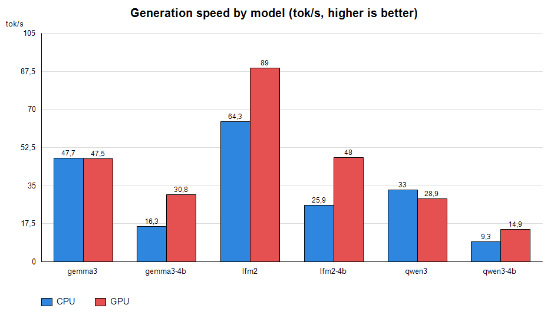
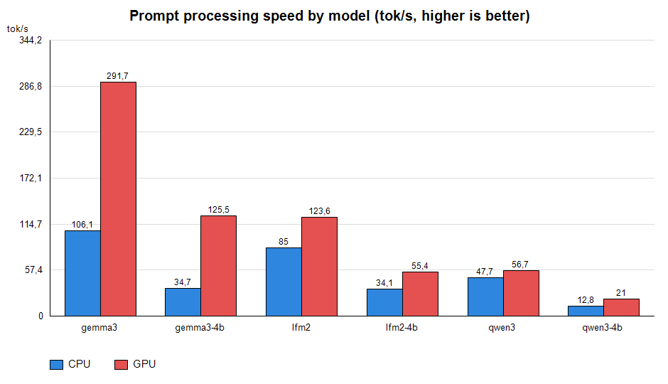

# LLM inference module (llm.c) + test_llm demo

> [Russian version](README_RU.md)

Self-contained C module for LLM inference on top of **ggml**. No dependencies other
than the ggml library. Runs on **CPU** and on a **Vulkan GPU** (NVIDIA / AMD / Intel).

Two parts:

- **`llm.h` / `llm.c`** — the inference module: GGUF loading, tokenizer, chat
  templates, tool calling, KV-cache reuse, generation.
- **`test_llm.c`** — console demo client (`test_llm.exe`): runs a prompt or an
  interactive dialog on CPU or GPU.

---

## 1. Advantages of the llm module

- **Self-contained** — a single C module (plus ggml), no runtime dependencies.
- **CPU + Vulkan GPU** — same code path; GPU is enabled explicitly (`--device gpu`).
- **Three architectures** in one module: qwen35 (hybrid Gated DeltaNet + attention),
  gemma3 (dense, sliding-window attention), lfm2 (dense, attention + shortconv).
- **Correct non-ASCII text** — byte-level BPE (gpt2-style), Cyrillic and other
  UTF-8 tokenize correctly.
- **Quantization** — primary path Q4_K_M (F32/Q4_K/Q6_K); F16, Q5_0, Q8_0 etc. run
  through the standard ggml kernels.
- **Fast**:
  - batched prompt processing (chunks up to 32 tokens per pass, ~2–6x);
  - OpenMP parallelization of matmul rows and attention heads;
  - batched Vulkan matmuls and a **fused GPU FFN** (gate/up + silu/gelu + down in a
    single graph submission);
  - KV cache with incremental prompt tail — multi-turn dialogs are nearly instant;
  - system-prompt warmup — the constant prefix is processed once;
  - single-pass tool calling.
- **Deterministic** — greedy mode (`--temp 0.0`) gives reproducible output; dense
  models produce **identical results on CPU and GPU**.
- **Debug-ready** — timing via `CHAT_TIMING`, CPU-only forced via `LLM_CPU_ONLY`.

---

## 2. Full description

### 2.1 Supported architectures

| Architecture | Description |
|---|---|
| `qwen35` | Hybrid: **Gated DeltaNet** blocks (linear attention / SSM with recurrent state `S`) + full-attention blocks; q/k-norm, partial RoPE; "thinking" reasoning blocks |
| `gemma3` | Dense, full attention, q/k-norm, sliding-window attention |
| `lfm2` | Dense, attention + **short-convolution** (shortconv) blocks; q/k-norm; recurrent conv state |

Models for testing (Q4_K_M):

| File | Download |
|---|---|
| `lfm2.gguf` | [LiquidAI/LFM2.5-1.2B-Instruct-GGUF](https://huggingface.co/LiquidAI/LFM2.5-1.2B-Instruct-GGUF) |
| `lfm2-4B.gguf` | [LiquidAI/LFM2.5-2.6B-GGUF](https://huggingface.co/LiquidAI/LFM2.5-2.6B-GGUF) |
| `qwen3.gguf` | [unsloth/Qwen3.5-0.8B-GGUF](https://huggingface.co/unsloth/Qwen3.5-0.8B-GGUF) |
| `qwen3-4b.gguf` | [unsloth/Qwen3.5-4B-GGUF](https://huggingface.co/unsloth/Qwen3.5-4B-GGUF) |
| `gemma3.gguf` | [bartowski/google_gemma-3-1b-it-GGUF](https://huggingface.co/bartowski/google_gemma-3-1b-it-GGUF) |
| `gemma3-4b.gguf` | [bartowski/google_gemma-3-4b-it-GGUF](https://huggingface.co/bartowski/google_gemma-3-4b-it-GGUF) |

The architecture is auto-detected from `general.architecture` in the GGUF.

### 2.2 Tokenizer and quantization

- Byte-level BPE (gpt2-style): UTF-8 bytes are mapped through the GPT-2
  byte-to-unicode table, so Cyrillic and other non-ASCII tokenize correctly.
  Special tokens (`<|im_start|>`, `<|begin_of_text|>`, ...) are handled atomically.
- Primary path is **Q4_K_M** (`F32`/`Q4_K`/`Q6_K`); `Q5_0`, `Q8_0`, `F16` (gemma3)
  also work through the ggml kernels.
- Thinking models (qwen3 style) reason in ` thinking` ... ` response` blocks; the
  reasoning block is stripped from the output, only the answer is shown.

### 2.3 Acceleration techniques

- **Batched prompt processing** — the prompt (the most expensive part, up to
  900+ tokens on the first turn) is processed in chunks of up to 32 tokens per
  pass: matmuls are batched over input columns; recurrent parts (GDN state,
  conv state, attention, norms, RoPE) stay per token. Gives ~2–6x on prompt speed.
- **OpenMP** — matmul row loops and the attention loop over heads are spread over
  threads (`--threads`).
- **Batched GPU matmul** — on Vulkan one `mul_mat` graph runs with a `[ne0, B]`
  input (B columns uploaded/read back in one call). Weights resident in VRAM are
  routed to the batched path automatically.
- **Fused GPU FFN** — the per-token FFN (gate/up matmuls + silu/gelu + mul + down)
  runs as a single graph submission, so the activation never leaves the GPU.
- **KV cache + incremental prompt** — dialog history is cached; on later turns only
  the new template tail is tokenized, so repeat turns are nearly instant.
- **System-prompt warmup** — the constant system prompt (+ tool definitions) is
  processed once into the KV cache after init; the first user turn becomes a short
  continuation.
- **Thinking-block stripping** — the qwen3-style reasoning block is removed from
  the displayed answer.
- **Single-pass tool calling** — one tool call is parsed, executed, its result
  injected into history and one follow-up generation runs.

### 2.4 GPU offload (Vulkan)

- Quantized matmul weights are copied to VRAM (`Vulkan<n>`); F32 tensors (norms,
  SSM parameters) stay on CPU.
- Matmuls run on the GPU (batched); attention, norms, softmax, token selection and
  shortconv stay on CPU.
- Embeddings are read back from VRAM and dequantized.
- If the requested GPU is missing, the module falls back to the first GPU, then to
  CPU. `LLM_CPU_ONLY=1` forces CPU-only.

### 2.5 Determinism

- `--temp 0.0` is greedy and deterministic.
- Dense models (gemma3, lfm2) produce **identical tokens on CPU and GPU**.
- qwen3-style models may diverge by a token at the edge of the argmax because GPU
  `silu` uses `expf` while the CPU path uses a lookup table (differences ~1e-6).

---

## 3. Used models

| File | Model | Arch | Layers | embd | ff | heads (kv) | ctx |
|---|---|---|---|---|---|---|---|
| `lfm2.gguf` | LFM2.5 1.2B | lfm2 | 16 (6 attn + 10 shortconv) | 2048 | 8192 | 32 (8) | 128k |
| `lfm2-4B.gguf` | LFM2.5 2.6B | lfm2 | 30 (8 attn + 22 shortconv) | 2048 | 10752 | 32 (8) | 131k |
| `gemma3.gguf` | Gemma 3 1B It | gemma3 | 26 | 1152 | 6912 | 4 (1) | 32k |
| `gemma3-4b.gguf` | Gemma 3 4B It | gemma3 | 34 | 2560 | 10240 | 8 (4) | 131k |
| `qwen3.gguf` | Qwen3.5-0.8B | qwen35 | 24 | 1024 | 3584 | 8 (2) | 262k |
| `qwen3-4b.gguf` | Qwen3.5-4B | qwen35 | 32 | 2560 | 9216 | 16 (4) | 262k |

---

## 4. Test results (CPU vs GPU)

Hardware: CPU (4 threads) + NVIDIA GeForce RTX 5070 Ti (Vulkan), 2026-09-25.
Binaries: `test_llm_cpu.exe` / `test_llm_gpu.exe` (`build_llm.bat all`).

### 4.1 Benchmark: single-prompt speed (`bench/run_bench.ps1`)

Conditions: threads = 4, greedy (`--temp 0.0`), `--predict 96`, `-c 4096`,
`LLM_NO_CACHE=1` (no warmup/reuse, clean measurement), Russian prompt.

| Model | CPU gen / prompt (tok/s) | GPU gen / prompt (tok/s) | GPU gen speedup | App total CPU / GPU (s) |
|---|---|---|---|---|
| `gemma3.gguf` (1B) | 47.7 / 106.1 | 47.5 / 291.7 | +0% | 2.8 / 2.3 |
| `gemma3-4b.gguf` (4B) | 16.3 / 34.7 | 30.8 / 125.5 | **+89%** | 7.6 / 3.8 |
| `lfm2.gguf` (1.2B) | 64.3 / 85.0 | 89.0 / 123.6 | **+38%** | 2.8 / 2.3 |
| `lfm2-4B.gguf` (2.6B) | 25.9 / 34.1 | 48.0 / 55.4 | **+85%** | 8.1 / 5.4 |
| `qwen3.gguf` (0.8B) | 33.0 / 47.7 | 28.9 / 56.7 | -12% | 5.6 / 5.6 |
| `qwen3-4b.gguf` (4B) | 9.3 / 12.8 | 14.9 / 21.0 | **+60%** | 22.1 / 14.6 |

Full table: `bench/bench_results.csv`. Charts: `bench/make_charts.ps1`.




Notes:

- **All models produce valid answers on both devices** (no crashes, no empty
  replies).
- **GPU prompt processing** is 1.2–3.6x faster (batched `mul_mat` graphs).
- **qwen3**: GPU generation is slower than CPU (-12%) — the GDN sequential
  state update is CPU-bound and per-matmul GPU overhead outweighs the small
  matmul win for this hybrid model.
- Greedy decoding is deterministic: repeated runs are bit-identical.

---

## 5. test_llm demo — parameters

```
test_llm.exe -m <model.gguf> [options] [-p "prompt"]
```

| Option | Description |
|---|---|
| `-m <file>` | model path (GGUF), required |
| `-c <n>` | context size (default 4096) |
| `-p <text>` | first user prompt (UTF-8) |
| `--threads <n>` | CPU threads (4–8 is usually optimal for 1–4B models) |
| `--temp <f>` | sampling temperature; `0.0` = greedy / deterministic |
| `--top-k <n>` | top-k sampling (>= 1) |
| `--top-p <f>` | nucleus sampling, in (0, 1] (e.g. `0.95`) |
| `--predict <n>` | max tokens per reply (default 512) |
| `--lang <code>` | response language hint (e.g. `ru`) |
| `--agent <file>` | initial agent/system prompt file (default `agent.md`) |
| `--tools` | enable system tools (volume control, launch app) |
| `--device <cpu\|gpu>` | compute device (GPU build only; default `cpu`) |
| `--gpu <n>` | Vulkan GPU number (GPU build only; `0, 1, ...` -> `Vulkan<n>`) |
| `-h, --help` | show help |

Environment variables:

| Variable | Effect |
|---|---|
| `CHAT_TIMING=1` | print per-step timing to stderr |
| `LLM_CPU_ONLY=1` | force CPU even in a GPU build |

Examples:

```bat
test_llm.exe -m lfm2-4B.gguf --threads 4 -c 2048 --lang ru --predict 512 --temp 0.6 -p "расскажи мне сказку"
test_llm.exe -m gemma3.gguf --threads 4 --device gpu -p "Привет!"
test_llm.exe -m qwen3.gguf --threads 8 -c 8192 --lang ru
```

Without `-p` an interactive input -> reply loop starts; exit with `exit`/`quit` or EOF.

### Building CPU and GPU binaries

```bat
build_llm.bat        :: test_llm.exe (CPU unless VULKAN_LIB is preset)
build_llm.bat cpu    :: test_llm_cpu.exe (CPU only)
build_llm.bat gpu    :: test_llm_gpu.exe (Vulkan, needs VULKAN_SDK)
build_llm.bat all    :: both binaries
```

### Tests and charts

```bat
powershell -ExecutionPolicy Bypass -File bench\run_bench.ps1    :: speed, all models x CPU/GPU -> bench/bench_results.csv
powershell -ExecutionPolicy Bypass -File bench\make_charts.ps1  :: PNG charts -> bench/charts/
```

`run_bench.ps1` accepts `-Only <names>` (e.g. `-Only gemma3,lfm2`) and skips
missing models/binaries instead of failing.

## License

GNU AGPL v3 (Affero GPL)
