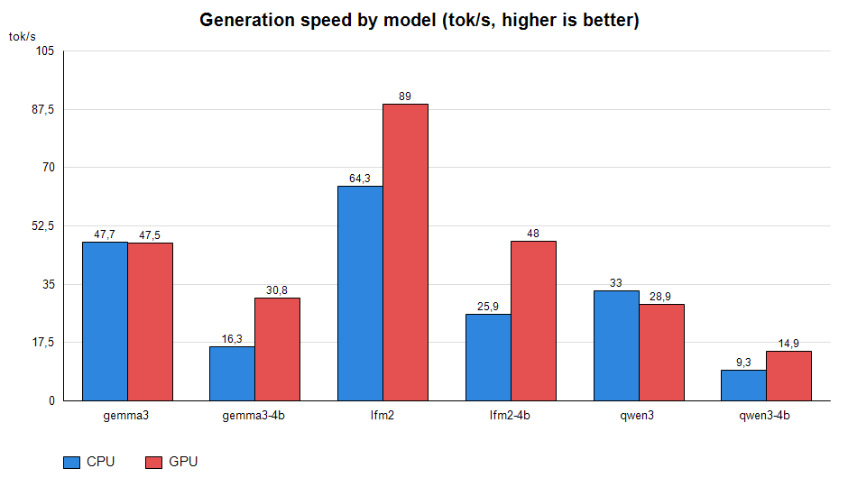
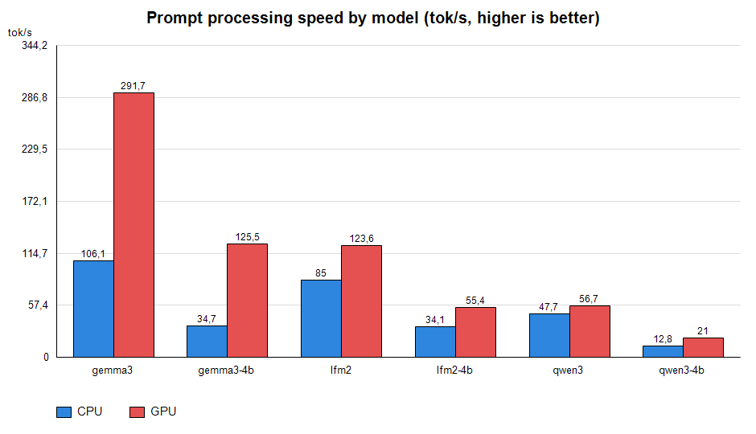

# Модуль инференса LLM (llm.c) + демо test_llm

> [English version](README.md)

Самодостаточный C-модуль для инференса LLM поверх **ggml**. Без внешних зависимостей,
кроме библиотеки ggml. Работает на **CPU** и на **Vulkan GPU** (NVIDIA / AMD / Intel).

Проект состоит из двух частей:

- **`llm.h` / `llm.c`** — модуль инференса: загрузка GGUF, токенизатор, chat-шаблоны,
  вызов инструментов, переиспользование KV-кэша, генерация.
- **`test_llm.c`** — консольное демо (`test_llm.exe`): разовый промпт или
  интерактивный диалог на CPU или GPU.

---

## 1. Преимущества модуля llm

- **Самодостаточный** — один C-модуль (плюс ggml), никаких внешних зависимостей.
- **CPU + Vulkan GPU** — единый код; GPU включается явно (`--device gpu`).
- **Три архитектуры** в одном модуле: qwen35 (гибрид Gated DeltaNet + attention),
  gemma3 (плотная, sliding-window attention), lfm2 (плотная, attention + shortconv).
- **Корректный не-ASCII текст** — byte-level BPE (gpt2-стиль), кириллица и другой
  UTF-8 токенизируются верно.
- **Квантизация** — основной путь Q4_K_M (F32/Q4_K/Q6_K); F16, Q5_0, Q8_0 и др.
  идут через штатные ggml-ядра.
- **Быстрый**:
  - пакетная обработка промпта (чанки до 32 токенов за проход, ~2–6x);
  - OpenMP-параллелизация строк матмулов и голов attention;
  - пакетные Vulkan-матмулы и **фьюженный GPU-FFN** (gate/up + silu/gelu + down
    одним графом);
  - KV-кэш с инкрементальным хвостом промпта — повторные ходы диалога почти
    мгновенны;
  - прогрев системного промпта — постоянный префикс обрабатывается один раз;
  - однопроходный вызов инструментов.
- **Детерминизм** — greedy-режим (`--temp 0.0`) воспроизводим; плотные модели дают
  **идентичный результат на CPU и GPU**.
- **Отладка** — тайминг через `CHAT_TIMING`, принудительный CPU через `LLM_CPU_ONLY`.

---

## 2. Полное описание

### 2.1 Поддерживаемые архитектуры

| Архитектура | Описание |
|---|---|
| `qwen35` | Гибрид: блоки **Gated DeltaNet** (линейная attention / SSM с рекуррентным состоянием `S`) + блоки полной attention; q/k-norm, частичный RoPE; «думающие» блоки рассуждений |
| `gemma3` | Плотная, полная attention, q/k-norm, sliding-window attention |
| `lfm2` | Плотная, attention + блоки **shortconv** (короткая свёртка); q/k-norm; рекуррентное conv-состояние |


Модели для тестирования (Q4_K_M):

| Файл | Скачать |
|---|---|
| `lfm2.gguf` | [LiquidAI/LFM2.5-1.2B-Instruct-GGUF](https://huggingface.co/LiquidAI/LFM2.5-1.2B-Instruct-GGUF) |
| `lfm2-4B.gguf` | [LiquidAI/LFM2.5-2.6B-GGUF](https://huggingface.co/LiquidAI/LFM2.5-2.6B-GGUF) |
| `qwen3.gguf` | [unsloth/Qwen3.5-0.8B-GGUF](https://huggingface.co/unsloth/Qwen3.5-0.8B-GGUF) |
| `qwen3-4b.gguf` | [unsloth/Qwen3.5-4B-GGUF](https://huggingface.co/unsloth/Qwen3.5-4B-GGUF) |
| `gemma3.gguf` | [bartowski/google_gemma-3-1b-it-GGUF](https://huggingface.co/bartowski/google_gemma-3-1b-it-GGUF) |
| `gemma3-4b.gguf` | [bartowski/google_gemma-3-4b-it-GGUF](https://huggingface.co/bartowski/google_gemma-3-4b-it-GGUF) |

Архитектура определяется автоматически по `general.architecture` в GGUF.

### 2.2 Токенизатор и квантизация

- Byte-level BPE (gpt2-стиль): байты UTF-8 маппятся через таблицу GPT-2
  byte-to-unicode, поэтому кириллица и другой не-ASCII токенизируются корректно.
  Специальные токены (`<|im_start|>`, `<|begin_of_text|>`, ...) обрабатываются
  атомарно.
- Основной путь — **Q4_K_M** (`F32`/`Q4_K`/`Q6_K`); `Q5_0`, `Q8_0`, `F16` (gemma3)
  также работают через ggml-ядра.
- «Думающие» модели (qwen3-стиль) рассуждают блоками ` thinking` ... ` response`;
  блок рассуждений отсекается при выводе, остаётся только ответ.

### 2.3 Методы ускорения

- **Пакетная обработка промпта** — промпт (самая затратная часть, до 900+ токенов
  на первый ход) обрабатывается чанками до 32 токенов за проход: матмулы батчатся
  по входным колонкам; рекуррентные части (GDN-состояние, conv-состояние,
  attention, нормы, RoPE) остаются по-токеновыми. Даёт ~2–6x на скорости промпта.
- **OpenMP** — циклы строк матмулов и цикл attention по головам распределяются по
  потокам (`--threads`).
- **Пакетный GPU-матмул** — на Vulkan один `mul_mat`-граф выполняется со входом
  `[ne0, B]` (B колонок загружаются и считываются одним вызовом). Веса в VRAM
  автоматически маршрутизируются в пакетный путь.
- **Фьюженный GPU-FFN** — по-токеновый FFN (gate/up матмулы + silu/gelu + mul +
  down) выполняется одним сабмитом графа, активация не покидает GPU.
- **KV-кэш + инкрементальный промпт** — история диалога кэшируется; на следующих
  ходах токенизируется только новый хвост шаблона, повторные ходы почти мгновенны.
- **Прогрев системного промпта** — постоянный системный промпт (+ описания
  инструментов) обрабатывается один раз в KV-кэш после инициализации; первый
  user-ход становится коротким продолжением.
- **Отсечение thinking-блока** — блок рассуждений qwen3-стиля убирается из вывода.
- **Однопроходный вызов инструментов** — один вызов инструмента парсится,
  исполняется, результат подставляется в историю, выполняется одна повторная
  генерация.

### 2.4 GPU-офлоад (Vulkan)

- Квантованные веса матмулов копируются в VRAM (`Vulkan<n>`); F32-тензоры (нормы,
  SSM-параметры) остаются на CPU.
- Матмулы выполняются на GPU (пакетами); attention, нормы, softmax, выбор токена
  и shortconv — на CPU.
- Эмбеддинги читаются обратно из VRAM и деквантизируются.
- Если запрошенная карта отсутствует — фолбэк на первую GPU, затем на CPU.
  `LLM_CPU_ONLY=1` форсирует CPU.

### 2.5 Детерминизм

- `--temp 0.0` — жадный, детерминированный выбор токена.
- Плотные модели (gemma3, lfm2) дают **идентичные токены на CPU и GPU**.
- Модели qwen3-стиля могут разойтись на одном токене на границе argmax, т.к.
  GPU-`silu` использует `expf`, а CPU-путь — таблицу значений (различие ~1e-6).

---

## 3. Используемые модели

| Файл | Модель | Архитектура | Слои | embd | ff | головы (kv) | ctx |
|---|---|---|---|---|---|---|---|
| `lfm2.gguf` | LFM2.5 1.2B | lfm2 | 16 (6 attn + 10 shortconv) | 2048 | 8192 | 32 (8) | 128k |
| `lfm2-4B.gguf` | LFM2.5 2.6B | lfm2 | 30 (8 attn + 22 shortconv) | 2048 | 10752 | 32 (8) | 131k |
| `gemma3.gguf` | Gemma 3 1B It | gemma3 | 26 | 1152 | 6912 | 4 (1) | 32k |
| `gemma3-4b.gguf` | Gemma 3 4B It | gemma3 | 34 | 2560 | 10240 | 8 (4) | 131k |
| `qwen3.gguf` | Qwen3.5-0.8B | qwen35 | 24 | 1024 | 3584 | 8 (2) | 262k |
| `qwen3-4b.gguf` | Qwen3.5-4B | qwen35 | 32 | 2560 | 9216 | 16 (4) | 262k |

---

## 4. Результаты тестов (CPU vs GPU)

Оборудование: CPU (4 потока) + NVIDIA GeForce RTX 5070 Ti (Vulkan), 2026-09-25.
Бинарники: `test_llm_cpu.exe` / `test_llm_gpu.exe` (`build_llm.bat all`).

### 4.1 Бенчмарк скорости на разовом промпте (`bench/run_bench.ps1`)

Условия: threads = 4, greedy (`--temp 0.0`), `--predict 96`, `-c 4096`,
`LLM_NO_CACHE=1` (без warmup/реюза, чистый замер), русский промпт.

| Модель | CPU gen / prompt (tok/s) | GPU gen / prompt (tok/s) | Ускорение gen | Время работы CPU / GPU (с) |
|---|---|---|---|---|
| `gemma3.gguf` (1B) | 47.7 / 106.1 | 47.5 / 291.7 | +0% | 2.8 / 2.3 |
| `gemma3-4b.gguf` (4B) | 16.3 / 34.7 | 30.8 / 125.5 | **+89%** | 7.6 / 3.8 |
| `lfm2.gguf` (1.2B) | 64.3 / 85.0 | 89.0 / 123.6 | **+38%** | 2.8 / 2.3 |
| `lfm2-4B.gguf` (2.6B) | 25.9 / 34.1 | 48.0 / 55.4 | **+85%** | 8.1 / 5.4 |
| `qwen3.gguf` (0.8B) | 33.0 / 47.7 | 28.9 / 56.7 | -12% | 5.6 / 5.6 |
| `qwen3-4b.gguf` (4B) | 9.3 / 12.8 | 14.9 / 21.0 | **+60%** | 22.1 / 14.6 |

Полная таблица: `bench/bench_results.csv`. Графики: `bench/make_charts.ps1`.




Примечания:

- **Все модели дают корректные ответы на обоих устройствах** (без падений
  и пустых ответов).
- **Обработка промпта на GPU** быстрее в 1.2–3.6 раза (пакетные `mul_mat`-графы).
- **qwen3**: генерация на GPU медленнее CPU (-12%) — последовательное
  обновление GDN-состояния выполняется на CPU, и оверхед мелких GPU-матмулов
  не окупается для этой гибридной модели.
- Greedy-декодирование детерминировано: повторные прогоны побитово идентичны.

---

## 5. Демо test_llm — параметры

```
test_llm.exe -m <model.gguf> [options] [-p "prompt"]
```

| Параметр | Описание |
|---|---|
| `-m <file>` | путь к модели (GGUF), обязателен |
| `-c <n>` | размер контекста (по умолчанию 4096) |
| `-p <text>` | первый user-промпт (UTF-8) |
| `--threads <n>` | число потоков CPU (для моделей 1–4B обычно 4–8) |
| `--temp <f>` | температура сэмплирования; `0.0` — жадный (детерминированный) |
| `--top-k <n>` | top-k сэмплирование (>= 1) |
| `--top-p <f>` | nucleus-сэмплирование, в (0, 1] (например `0.95`) |
| `--predict <n>` | максимум токенов на ответ (по умолчанию 512) |
| `--lang <code>` | подсказка языка ответа (например `ru`) |
| `--agent <file>` | файл системного/агентного промпта (по умолчанию `agent.md`) |
| `--tools` | включить системные инструменты (громкость, запуск приложений) |
| `--device <cpu\|gpu>` | вычислительное устройство (только GPU-сборка; по умолчанию `cpu`) |
| `--gpu <n>` | номер Vulkan-карты (только GPU-сборка; `0, 1, ...` -> `Vulkan<n>`) |
| `-h, --help` | справка |

Переменные окружения:

| Переменная | Эффект |
|---|---|
| `CHAT_TIMING=1` | выводить пошаговый тайминг в stderr |
| `LLM_CPU_ONLY=1` | принудительно использовать только CPU даже в GPU-сборке |

Примеры:

```bat
test_llm.exe -m lfm2-4B.gguf --threads 4 -c 2048 --lang ru --predict 512 --temp 0.6 -p "расскажи мне сказку"
test_llm.exe -m gemma3.gguf --threads 4 --device gpu -p "Привет!"
test_llm.exe -m qwen3.gguf --threads 8 -c 8192 --lang ru
```

Без `-p` запускается цикл «ввод → ответ»; выход по `exit`/`quit` или EOF.

### Сборка CPU- и GPU-бинарников

```bat
build_llm.bat        :: test_llm.exe (CPU, если не задан VULKAN_LIB)
build_llm.bat cpu    :: test_llm_cpu.exe (только CPU)
build_llm.bat gpu    :: test_llm_gpu.exe (Vulkan, нужен VULKAN_SDK)
build_llm.bat all    :: оба бинарника
```

### Тесты и графики

```bat
powershell -ExecutionPolicy Bypass -File bench\run_bench.ps1    :: скорость, все модели x CPU/GPU -> bench/bench_results.csv
powershell -ExecutionPolicy Bypass -File bench\make_charts.ps1  :: PNG-графики -> bench/charts/
```

`run_bench.ps1` принимает `-Only <имена>` (например `-Only gemma3,lfm2`)
и пропускает отсутствующие модели/бинарники вместо падения.

## License

GNU AGPL v3 (Affero GPL)
