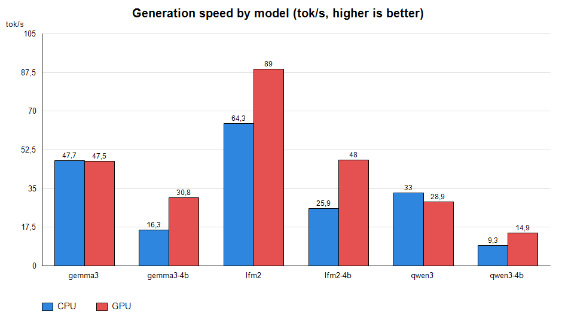
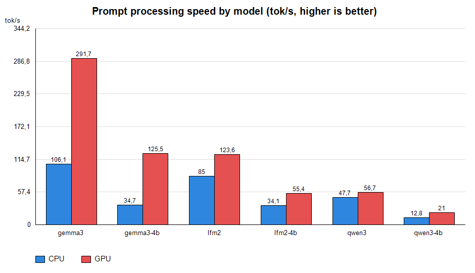

# Бенчмарк модуля `llm`: скорость CPU vs GPU

Дата: 2026-09-25.
Оборудование: CPU (4 потока) + NVIDIA GeForce RTX 5070 Ti (Vulkan).
Бинарники: `test_llm_cpu.exe` / `test_llm_gpu.exe` (`build_llm.bat all`).

Условия: threads = 4, greedy (`--temp 0.0`), `--predict 96`, `-c 4096`,
`LLM_NO_CACHE=1` (без warmup и переиспользования KV — чистый замер),
русский промпт. Метрики — из `llm_print_stats`: prompt tok/s (обработка
промпта) и generate tok/s (по-токеновая генерация), плюс полное время работы
приложения (`total wall time (main)`).

Прогон: `powershell -ExecutionPolicy Bypass -File bench\run_bench.ps1`
(фильтр `-Only gemma3,lfm2`; пропуски вместо падений при отсутствии файлов).
Графики: `bench/make_charts.ps1` (только System.Drawing) → `bench/charts/`.

---

## 1. Результаты (все 6 моделей, CPU и GPU)

| Модель | Параметры | CPU gen / prompt (tok/s) | GPU gen / prompt (tok/s) | Ускорение gen | Время работы CPU / GPU (с) |
|---|---|---|---|---|---|
| gemma3 (1B) | 1B | 47.7 / 106.1 | 47.5 / 291.7 | +0% | 2.8 / 2.3 |
| gemma3-4b (4B) | 4B | 16.3 / 34.7 | 30.8 / 125.5 | **+89%** | 7.6 / 3.8 |
| lfm2 (1.2B) | 1.2B | 64.3 / 85.0 | 89.0 / 123.6 | **+38%** | 2.8 / 2.3 |
| lfm2-4B (2.6B) | 2.6B | 25.9 / 34.1 | 48.0 / 55.4 | **+85%** | 8.1 / 5.4 |
| qwen3 (0.8B) | 0.8B | 33.0 / 47.7 | 28.9 / 56.7 | -12% | 5.6 / 5.6 |
| qwen3-4b (4B) | 4B | 9.3 / 12.8 | 14.9 / 21.0 | **+60%** | 22.1 / 14.6 |

Ток/с (выше = лучше). Полная таблица: `bench/bench_results.csv`.

---

## 2. Выводы

1. **GPU сильно ускоряет обработку промпта** (пакетный путь `llm_mm_vk_batch`:
   один `mul_mat`-граф на B входных колонок): gemma3-4b — в 3.6 раза
   (34.7 → 125.5), gemma3 — в 2.7 раза (106 → 292), qwen3-4b — в 1.6 раза.
2. **GPU ускоряет генерацию больших моделей** (+38…+89% на 1.2B–4B): сработал
   пакетный матмул (qkv / gdn-группы / gate+up одним графом — см. `llm_mm_multi`
   в `llm.c`) и фьюженный GPU-FFN.
3. **На маленьких моделях GPU почти не выигрывает**: gemma3 gen 47.5 ≈ 47.7,
   qwen3 gen 28.9 < 33.0 — при маленьких матрицах доминируют накладные расходы
   сабмита/синхронизации, а не сама арифметика.
4. **qwen3 медленнее на GPU** (-12%): последовательное обновление GDN-состояния
   выполняется на CPU, оверхед мелких GPU-матмулов не окупается для гибридной
   модели.
5. **CPU-генерация упирается в память**, а не в ядра: 4B-модели дают ~9–16 tok/s
   на CPU независимо от тонкой настройки потоков.
6. Все прогоны завершились корректными ответами (без падений и пустых replies);
   greedy-декодирование детерминировано (повторные прогоны побитово идентичны).

---

## 3. Что дальше (по приоритету)

| # | Изменение | Ожидаемый эффект |
|---|---|---|
| 1 | Один GPU-граф на весь токен (сейчас группами только матмулы с общим входом; нормы/RoPE/attention — CPU-циклы между графами) | GPU gen: 1.5–4x |
| 2 | Офлоад attention на GPU (`q@k^T`, `attn@v` как `mul_mat`) | выигрыш на длинных контекстах |
| 3 | Асинхронность/overlap загрузки и вычитки (double-buffer) | скрыть host↔device latency |
| 4 | Speculative decoding (пакетный путь `llm_forward_batch_*` уже готов) | CPU gen: 1.5–2x |
| 5 | Диагностика единичного флипа n_gen (53→96, не воспроизводится): прогнать серией с `OMP_NUM_THREADS=1`; проверить порядок редукций в `llm_attn_apply_hd` / `llm_mm_multi_cpu` | детерминизм |

---

## 4. Артефакты

- `bench/run_bench.ps1` — скрипт бенчмарка (параметры: `-Threads`, `-Ctx`,
  `-Predict`, `-Prompt`, `-Only`).
- `bench/bench_results.csv` — полные результаты (инвариантная культура,
  точки вместо запятых).
- `bench/make_charts.ps1` — PNG-графики без внешних зависимостей.
- `test_llm_cpu.exe` / `test_llm_gpu.exe` — CPU-only и Vulkan сборки
  (`build_llm.bat cpu|gpu|all`; по умолчанию `build_llm.bat` собирает
  `test_llm.exe` как раньше).
